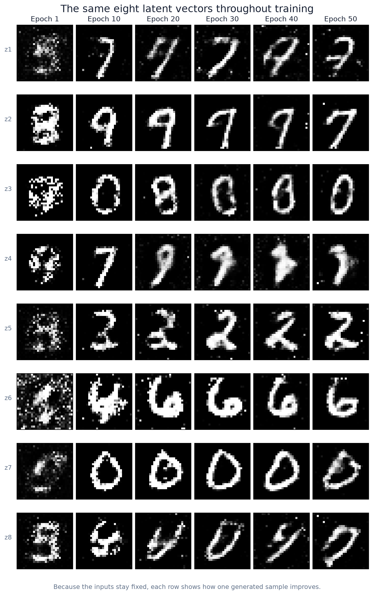
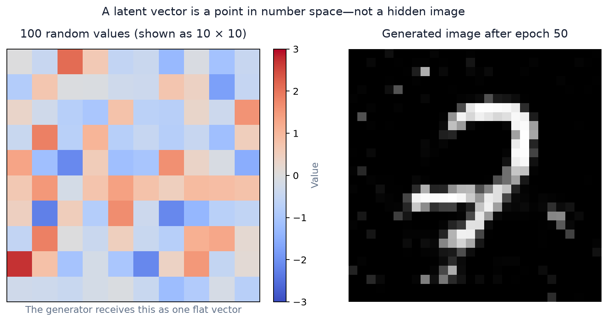
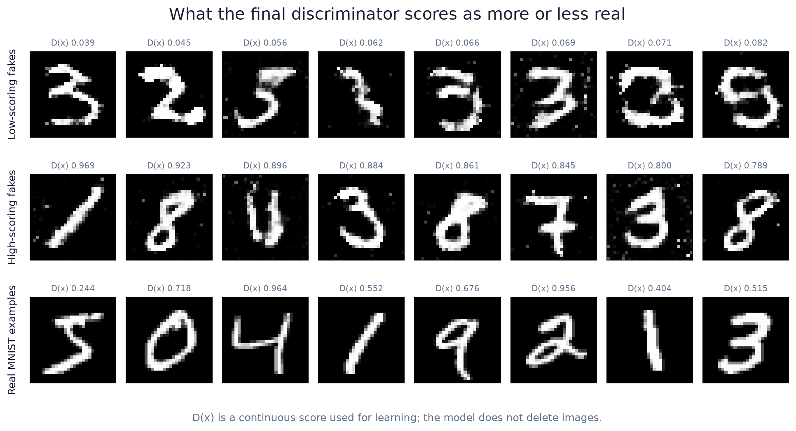
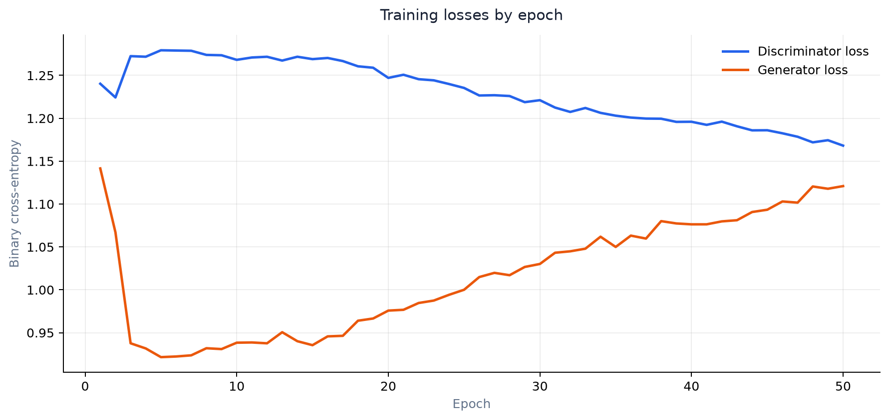

# MNIST GAN from Scratch

A small, fully connected Generative Adversarial Network (GAN) that learns to draw handwritten digits from random noise. The project is intentionally compact: the generator and discriminator are implemented directly in PyTorch and trained on MNIST.



The rows above always use the **same latent vectors**. Keeping the input fixed lets us see what the generator learns: early outputs contain scattered pixels and broken strokes, while later outputs become cleaner and more digit-like.

## How the GAN learns

```mermaid
flowchart LR
    Z[Random latent vector<br/>100 values] --> G[Generator]
    G --> F[Generated 28 × 28 image]
    R[Real MNIST image] --> D[Discriminator]
    F --> D
    D --> S[Realness score D(x)]
    S --> LD[Train discriminator<br/>real → 1, fake → 0]
    S --> LG[Train generator<br/>make fake → 1]
```

The two networks improve by competing:

1. The **generator** turns random vectors into images.
2. The **discriminator** scores both real MNIST images and generated images.
3. The discriminator learns to separate real from generated examples.
4. The generator uses the discriminator's gradients to make its next images more convincing.

## What does a latent vector look like?



The latent input is not a tiny hidden digit. It is a point containing 100 random numbers sampled from a normal distribution. The 10 × 10 heatmap is only a convenient way to display those values; the generator receives them as one flat vector. Nearby points in this learned number space can produce visually related digits.

## Does the discriminator reject images?



Not literally. The discriminator does not delete an image or permanently accept it. It returns a continuous score, `D(x)`, between 0 and 1:

- A score near **0** means "this currently looks generated."
- A score near **1** means "this currently looks like MNIST."
- That score supplies gradients that update both networks during training.

The figure uses the **final trained discriminator**. The low- and high-scoring generated examples were selected from the same deterministic pool of 256 samples. Cleaner, centered, continuous strokes often score higher; noisy, fragmented, or ambiguous marks often score lower. These are measurements from one training run, not universal rules, and a high score does not prove that a digit is good.

## Training behavior



GAN losses compete rather than moving smoothly toward zero. A rising generator loss can mean the discriminator temporarily became stronger, while a falling discriminator loss can mean it found the current fakes easy to identify. The generated samples are therefore as important as the loss curves when judging progress.

## Architecture

### Generator

| Layer | Output | Activation |
|---|---:|---|
| Latent input | 100 | — |
| Linear | 256 | LeakyReLU(0.2) |
| Linear + BatchNorm | 512 | LeakyReLU(0.2) |
| Linear + BatchNorm | 1024 | LeakyReLU(0.2) |
| Linear | 784 | Tanh |
| Reshape | 1 × 28 × 28 | — |

### Discriminator

| Layer | Output | Activation |
|---|---:|---|
| Flattened image | 784 | — |
| Linear | 512 | LeakyReLU(0.2) |
| Linear | 256 | LeakyReLU(0.2) |
| Linear | 1 | Sigmoid |

Both networks use binary cross-entropy loss. Adam uses a learning rate of `0.001` and betas `(0.5, 0.999)`.

## Run it locally

From the repository root:

```bash
python3 -m venv venv
source venv/bin/activate
pip install -r src/requirements.txt
```

Train the reproducible 50-epoch documentation run:

```bash
python src/main.py \
  --epochs 50 \
  --seed 42 \
  --run-dir generated/readme-run
```

Training automatically uses CUDA when PyTorch can access it and otherwise uses the CPU. MNIST images are normalized from `[0, 1]` to `[-1, 1]` to match the generator's `Tanh` output.

Regenerate every README figure from the measured run:

```bash
python src/generate_readme_assets.py \
  --run-dir generated/readme-run \
  --output-dir docs/assets
```

For a quick pipeline check, limit the number of batches:

```bash
python src/main.py --epochs 1 --max-batches 2 --run-dir generated/smoke-test
```

## Generated artifacts

Each run directory contains:

```text
samples/              one 8 × 8 image grid per epoch
milestones/           tensors captured at epochs 1, 10, 20, 30, 40, and 50
generator.pth          final generator weights
discriminator.pth      final discriminator weights
fixed_noise.pt         latent vectors reused for visual comparisons
analysis_noise.pt      deterministic pool used for discriminator evidence
real_samples.pt        fixed MNIST reference samples
metrics.csv            epoch-average generator and discriminator losses
config.json            seed and training configuration
```

Raw training runs and model checkpoints are reproducible and intentionally ignored by Git. The four curated figures under `docs/assets/` are kept with the repository so this README renders without retraining.

## Limitations

- This is a basic multilayer-perceptron GAN, not a convolutional GAN.
- MNIST is small and simple; performance here does not imply success on natural images.
- GAN training can be unstable, and another seed or dependency version may produce different digits.
- The discriminator score measures what this discriminator learned—not human readability or the true identity of a digit.
